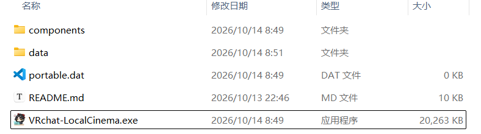
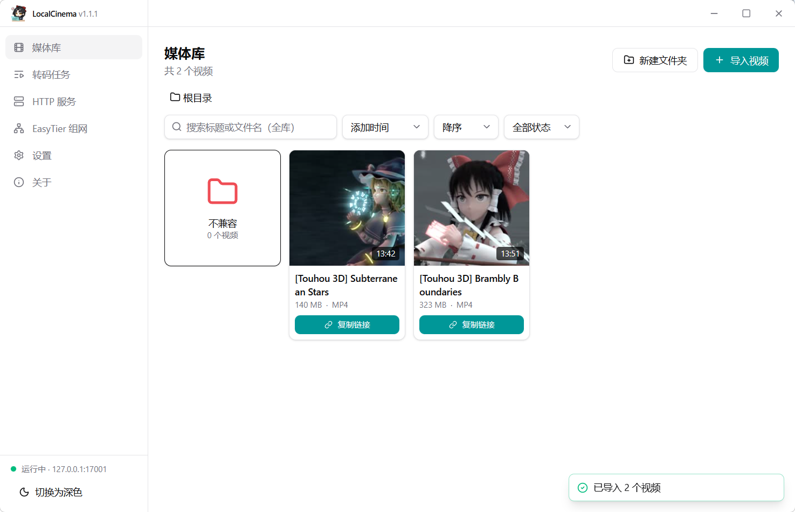
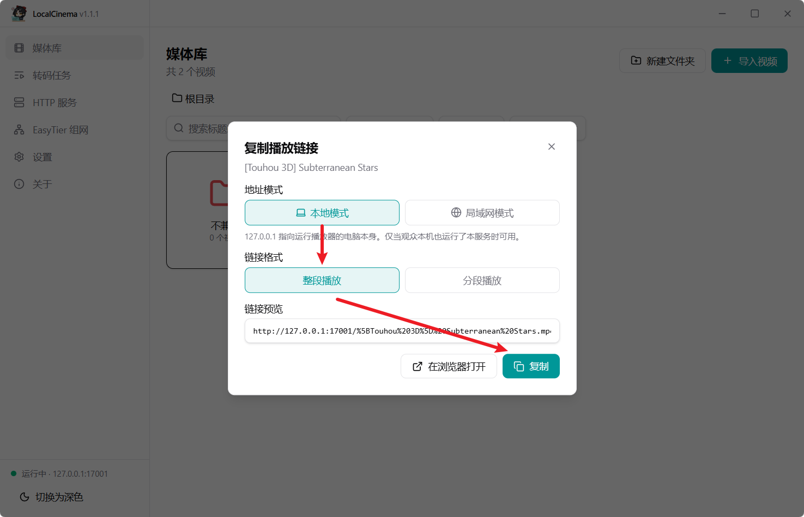
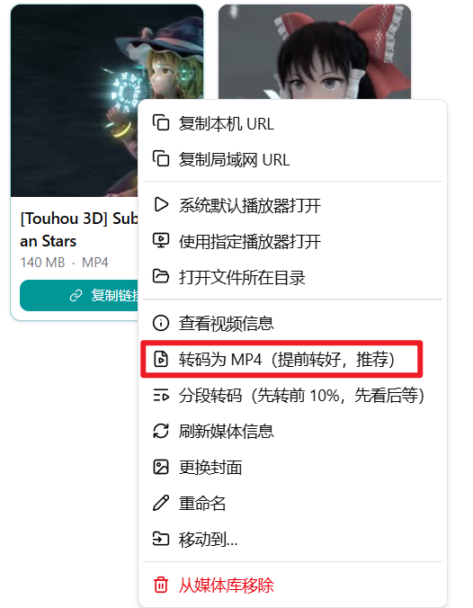
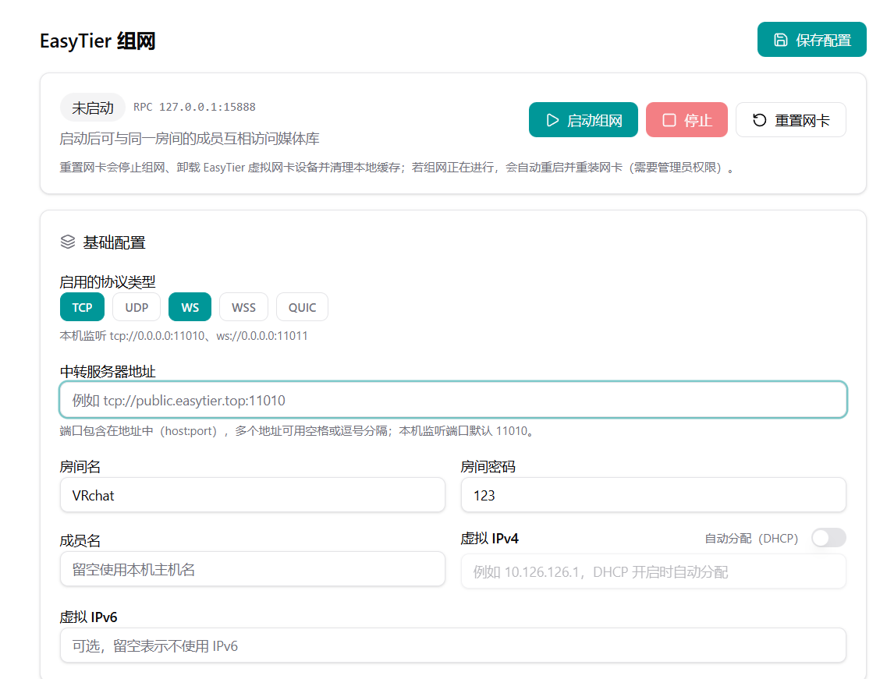
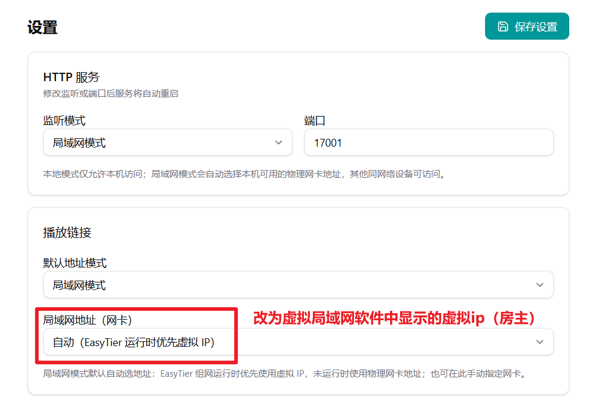
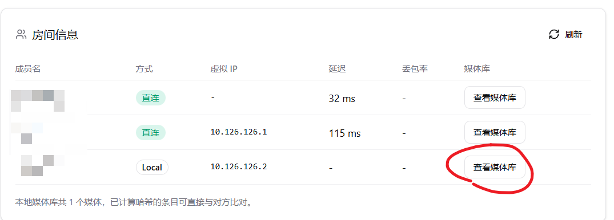
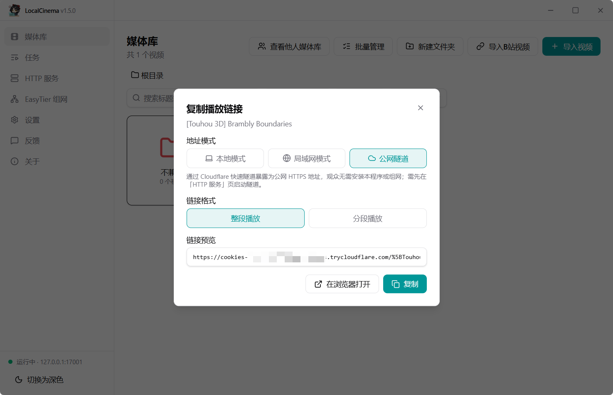

## VRchat-Localcinema

### VRC本地媒体库 —— 让你在电影房里播放本地电脑视频

by FlandreSatori

### 一、下载和安装

发布包格式为：

- `VRchat-Localcinema-xxxx-base.zip`
- `VRchat-Localcinema-xxxx-full.zip`

首次下载需选择完整版（full），解压到你喜欢的位置，效果如下：

目录 **data** 

- 会在首次运行后生成，包含`媒体库索引`、`封面缓存`和`转码视频文件`；

目录 **components**

- 包含可选的Easytier联网组件、FFmpeg转码组件、CloudFlared组件；

**后续更新**只用下载精简版（base），覆盖软件本体即可。

### 二、本地播放（适合对画质有要求的用户，推荐 ★ ★ ★ ★ ★ ）

#### 导入视频

把下载好的视频存放到任意你喜欢的位置，然后点击“导入视频”或者直接拖动视频到软件窗口。

> ⚠️注意，导入视频只是让软件记住该视频文件的位置，并不会复制一份视频到数据目录，因此不要随意更改原视频的文件名和路径。

导入完成后，媒体库会显示视频封面、文件名、大小、时长等信息。

#### 怎么生成电影房可以播放的链接？

- 对于导入正常的视频，直接点击 “**复制链接”** - “**本地模式**”  - **复制** 即可。
- 对于导入提示”**不兼容**“的视频，点击 “**转码为MP4**” 或者先右键再点击“转码为MP4”，转码任务完成后会将可播放的视频显示到主页。

#### 导入的视频提示不兼容怎么办？

- 针对VRchat电影房的播放器，我们正在测试可以正常解码的视频格式，确认其可以正常播放后才会把对应格式加入白名单，否则显示为”**不兼容**“。

#### 怎么强制播放不兼容的视频？（慎用）

- 你可以对视频右键 - 复制本机URL ，然后粘贴到VRchat电影房里观察它是否加载。

- 🎉如果你发现一个被我们标记为“**不兼容**”的视频，但实际上可以播放，请告诉我们。

#### 转码时我的电脑非常卡，怎么取消转码？

- 点击左侧菜单里的“**任务**”，你可以查看转码进度或者取消任务。

#### 我们忘记提前转码视频了，现在就想看视频，怎么办？

- 右键视频，点击“**分段转码**”，可以先转前10分钟的视频（每个人都要转），观看第一段的时候后台继续转码其余部分。

- 看完第一段视频后，再输入第二段视频链接即可。

#### 为什么只有我自己能看到视频？

- 当玩家的电脑加载VRchat房间时，其内包含的播放器是运行在玩家自己的电脑上的。

- 因此当房主设置了播放连接为本地链接（比如`http://127.0.0.1:17001/test.mp4`）时，播放器会在自己电脑上寻找对应的视频并播放。

- 未安装本程序或未导入相同视频到媒体库的玩家无法播放。

#### 那就是说必须提前让每个人都下好视频且导入到媒体库吗？

- 如果要追求高画质，那么是的，并且文件名需要相同。

- 如果你们通过Easytier组网了，可以尝试直接**访问对方的媒体库**并下载视频，详见[章节四](#四、查看他人媒体库（可以快速传输视频）)。

- 如果你只是想快速分享视频，并且路人也能直接看到，可以使用**公网隧道**，详见[章节五](#五、公网隧道播放（适合对画质要求不高的用户，推荐 ★ ★ ★）)。

#### 我导入了和房主一样的视频，为什么还是看不到画面？

打开浏览器，输入房主输入到播放器的链接（应该与你在媒体库中相同视频点击复制链接生成的链接一致），观察浏览器是否正常播放。

- 如果你生成的链接与房主的不一致，请检查**文件名是否相同**，检查**设置**中的**监听模式**、**端口号**是否相同。
- 如果你的浏览器无法打开链接，请检查HTTP服务是否正常运行，如果无法正常启动，说明默认端口被其他程序占用，请所有人**更换其他端口号**（推荐10000-60000的数字）。

### 三、异地播放（适合不想提前下载的用户，推荐 ★ ★ ★ ★ ）

此章节面对想要临时一起观影，但只有房主有视频资源的情况。

**房主**需要同时运行**本软件**和**组网软件**（或内置的Easyier），**其他人**只需运行组网软件。

**原理**：所有人通过虚拟局域网相互连接，然后直接访问房主的视频文件

#### 第一步

- 我会使用其他虚拟局域网软件（如UU加速器，蒲公英等）

  请自行查找使用方法。（p.s. UU加速器**不支持**加速游戏的同时组网）

- 我不会其他虚拟局域网软件，我想使用Easytier

  Easytier是一个强大的支持自定义中转服务器的开源软件。

  你可以点击[这里](https://ruixuan.online/uptime/easytier)找到当前可用的**公益中转服务器**节点，也可以点击[这里](https://www.easytier.cn/guide/installation.html)选择自行购买公网服务器搭建中转节点。

  

  找到可用的中转服务器地址后，填写下列参数：

  - 中转服务器地址
  - 房间名和房间密码（需所有人保持一致）
  - 成员名（给自己取个名字）
  - 虚拟IPv4（如果你不懂，请直接勾选 DHCP）
  
  

然后点击“**启动组网**”，软件会申请一次软件本体防火墙允许（用于开启HTTP服务）、一次windows powershell允许（用于注册计划任务）、一次easytier-core防火墙允许（用于组网），后续不再申请。

#### 第二步

组网完成后，房主需要修改软件设置中的**监听模式**为局域网模式，**局域网地址**选择 UU加速器/Easytier 分配给你的虚拟ip。

（如果你使用内置的EasyTier，该步会自动完成）

房主点击“复制链接”并输入到播放器即可。

如果有人看不到视频，让TA在浏览器里输入播放链接测试，并检查两台主机之间的连通性。

### 四、查看他人媒体库（可以快速传输视频）

- 点击“查看他人媒体库”，可以快速查看对方的媒体库情况，并可以选择一键下载对方的视频到本地。

- 下载速度与对方的上传带宽有关，如果上传带宽为50M，则对应的下载速度大约为4MB/s。

#### 我不想被其他人看到我的媒体库怎么办？

- 关闭设置页的“允许其他人查看我的媒体库”。

### 五、公网隧道播放（适合对画质要求不高的用户，推荐 ★ ★ ★）

**此方法受限于上传带宽，强烈建议压制视频后播放！！**

#### CloudFlare隧道（推荐）

此服务要求房主和观众**魔法上网**。

- 在HTTP服务中启动CloudFlare隧道
- 点击复制链接 - 公网隧道 

#### Sakura Frp隧道（不推荐）

此服务要求房主在SakuraFrp完成**实名认证**并手动创建隧道。

- 如果你是小白，该隧道的效果**不会**比CloudFlare更好！
- 如果你**未持有**任何域名，请**停止阅读**这一章节！

- 点击这里[注册](https://www.natfrp.com/user)账号

- 支付 ¥1.00 完成[实名认证](https://www.natfrp.com/user/realname)

  > **实名认证费用为SakuraFrp收取**，与本软件无关
  >
  > **请知悉，没有备案域名的用户只能使用海外节点**

- 点击[服务](https://www.natfrp.com/tunnel/)，创建隧道，选择要使用的节点

  

- 绑定本地端口为软件使用的端口，绑定你持有的域名，协议选择HTTP

  

- 在你的域名提供商处，添加一条CNAME解析，把绑定域名解析到到SakuraFrp提供的节点域名

  

### 六、如何反馈问题并得到回复

软件的“**关于**”界面可以找到作者的[B站](https://space.bilibili.com/2199618)和[仓库](https://github.com/FlandreSatori/VRchat-LocalCinema/issues)链接，欢迎私信或提交issue🎉。
